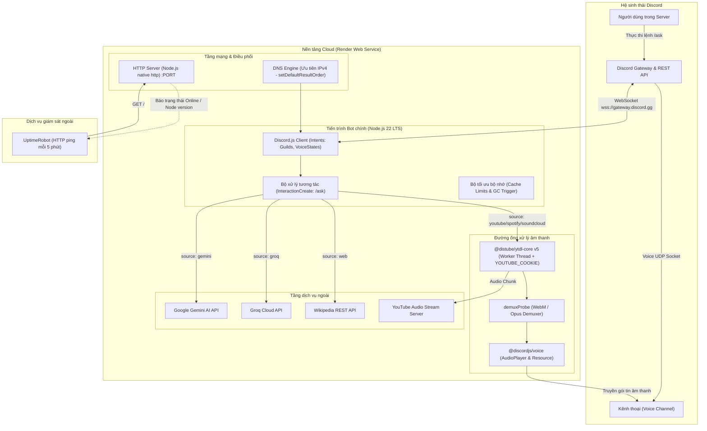

# KIẾN TRÚC HỆ THỐNG VÀ LỊCH SỬ PHÁT TRIỂN DISCORD BOT

Tài liệu này tổng hợp toàn bộ cấu trúc công nghệ, sơ đồ vận hành, chi tiết các thành phần và toàn bộ quá trình sửa lỗi, tối ưu hóa của bot Discord đa chức năng (Voice, AI, Music, Web) từ nền tảng Discloud sang Render Web Service.

---

## 1. Tổng Quan Hệ Thống

Bot là một ứng dụng Node.js hướng sự kiện (Event-driven Architecture), phục vụ 3 nhóm chức năng chính trong máy chủ Discord:
1. **Phát nhạc và âm thanh chất lượng cao vào Voice Channel**: Hỗ trợ YouTube, Spotify, SoundCloud thông qua luồng nén Opus/WebM.
2. **Truy vấn Trí tuệ nhân tạo (AI)**: Tích hợp Google Gemini (`gemini-3.8-flash`, `gemini-3.5-flash-lite`) và Groq Cloud (`openai/gpt-oss-20b`).
3. **Tra cứu bách khoa toàn thư Web**: Tích hợp trực tiếp Wikipedia API để tóm tắt thông tin tức thì.
4. **Cơ chế chống ngủ đông (Keep-Alive)**: Tích hợp HTTP Server nội tại để đáp ứng tiêu chuẩn Web Service trên Render và nhận ping định kỳ từ UptimeRobot.

---

## 2. Sơ Đồ Kiến Trúc Hệ Thống (Architecture Diagram)



---

## 3. Toàn Bộ Công Nghệ Đang Sử Dụng (Tech Stack)

### 3.1. Nền tảng thực thi & Hosting
- **Runtime**: **Node.js 22 LTS** (`engines: >=22.0.0` trong `package.json`).
- **Nền tảng Cloud**: **Render Web Service** (Gói Free Tier, Linux Container).
- **Containerization**: **Docker** (`node:22-slim`) cài sẵn `ffmpeg`, `python3`, `g++`, `make`.
- **Dịch vụ giám sát**: **UptimeRobot** gửi request HTTP định kỳ 5 phút/lần chống ngủ đông (15 phút inactive sleep).

### 3.2. Thư viện & Module cốt lõi
| Tên gói | Phiên bản | Vai trò trong hệ thống |
| :--- | :--- | :--- |
| `discord.js` | `^14.27.0` | Kết nối Discord Gateway v10, quản lý tương tác và Slash Commands. |
| `@discordjs/voice` | `^0.19.2` | Kết nối kênh đàm thoại Voice Channel, tạo AudioPlayer, mã hóa gói UDP âm thanh. |
| `@distube/ytdl-core` | `^5.2.0` | Giải mã chữ ký thuật toán YouTube, tải stream audio WebM/Opus bằng Worker Threads. |
| `@google/generative-ai` | `^0.24.1` | Kết nối API Google Gemini AI. |
| `groq-sdk` | `^1.6.0` | Kết nối siêu tốc độ tới mô hình mã nguồn mở trên Groq LPU. |
| `prism-media` | `^1.3.5` | Xử lý và chuyển đổi luồng dữ liệu media (WebM/Opus). |
| `opusscript` | `^0.0.8` | Bộ mã hóa âm thanh Opus thuần JavaScript (không phụ thuộc C++ native build). |
| `dotenv` | `^18.0.9` | Nạp biến môi trường từ `.env`. |
| `http` *(Native)* | Built-in | Tạo HTTP Health Check server không tốn RAM, không dùng Express. |
| `dns` *(Native)* | Built-in | Kiểm soát cơ chế phân giải tên miền (DNS Resolution). |

---

## 4. Toàn Bộ Những Gì Đã Sửa Đổi & Lịch Sử Xử Lý Sự Cố

### Vấn đề 1: Tràn bộ nhớ (OOM - Out of Memory) thời kỳ Discloud
- **Triệu chứng**: Bot bị Discloud tự động hủy tiến trình do chạm ngưỡng 100MB RAM.
- **Nguyên nhân**:
  1. Thư viện `@discordjs/opus` biên dịch C++ native gây ngốn RAM lúc build và chạy.
  2. `discord.js` mặc định lưu cache toàn bộ tin nhắn, thành viên, reaction, presence...
  3. Tiến trình con `ffmpeg` chạy nền tiêu hao thêm bộ nhớ ngoài tầm kiểm soát của Node.
- **Đã xử lý**:
  - Gỡ bỏ hoàn toàn `@discordjs/opus`, chuyển sang dùng `opusscript` siêu nhẹ.
  - Vô hiệu hóa toàn bộ cache thừa bằng `Options.cacheWithLimits`:
    ```javascript
    makeCache: Options.cacheWithLimits({
      MessageManager: 0, PresenceManager: 0, UserManager: 0,
      GuildMemberManager: 0, ReactionManager: 0, ThreadManager: 0, ...
    })
    ```
  - Lọc trực tiếp luồng stream WebM/Opus (`filter: f => f.container === 'webm' && f.hasAudio && !f.hasVideo`) để đưa trực tiếp vào `demuxProbe`, loại bỏ hoàn toàn việc gọi tiến trình transcoding qua `ffmpeg`.
  - Cài đặt cơ chế kích hoạt Garbage Collection (`global.gc()`) định kỳ và sau mỗi lượt hoàn thành lệnh.

---

### Vấn đề 2: Chuyển đổi nền tảng sang Render Web Service
- **Nhiệm vụ**: Chuyển đổi bot từ Discloud sang Render Web Service.
- **Đã xử lý**:
  - Tích hợp HTTP Server nội tại sử dụng module `http` của Node.js (không cài thêm thư viện nặng như express) lắng nghe cổng `process.env.PORT || 3000`.
  - Phản hồi mã HTTP 200 kèm trạng thái bot (`Bot is running!`) để Render nhận diện dịch vụ sống (Healthy).
  - Cập nhật script `npm start` = `node index.js`.
  - Xóa bỏ file `discloud.config` và dọn dẹp file cấu hình.
  - Soạn thảo tài liệu `HUONG_DAN_RENDER.md` chi tiết.

---

### Vấn đề 3: Bot bị kẹt Offline trên Discord sau khi Render báo "Service is Live"
- **Triệu chứng**: HTTP server trả về 200, Render báo Live nhưng trên Discord bot hiển thị "Ngoại tuyến" (Offline). Endpoint chẩn đoán ghi nhận bot kẹt tại:
  `debug: Preparing to connect to the gateway... (ws: 3)`
- **Nguyên nhân**:
  1. File `index.js` có đoạn mã cũ `setGlobalDispatcher(new Agent({ maxHeaderSize: 131072 }))` từ gói `undici`. Dispatcher này can thiệp vào `fetch` toàn cục và chặn đứng các request REST v10 của `discord.js` gửi đến `https://discord.com/api/v10/gateway/bot`.
  2. Môi trường container Linux của Render không định tuyến ra ngoài qua IPv6, trong khi Node.js mặc định truy vấn địa chỉ IPv6 (AAAA) trước. Gói tin TCP gửi đến Gateway bị rơi vào hố đen (black hole) gây treo tiến trình bắt tay.
- **Đã xử lý**:
  - Xóa bỏ hoàn toàn gói `undici` và lệnh `setGlobalDispatcher`.
  - Bổ sung cấu hình ép buộc ưu tiên IPv4 ngay tại đầu file chạy:
    ```javascript
    try {
      dns.setDefaultResultOrder('ipv4first');
    } catch {}
    ```
  - Kết quả: Bot kết nối thành công tới Discord Gateway ngay lập tức, chuyển sang trạng thái Trực tuyến (Online).

---

### Vấn đề 4: Lỗi sập Worker Thread giải mã YouTube (`Could not prepare player`)
- **Triệu chứng**: Khi dùng lệnh phát nhạc (`/ask source:youtube` hoặc `soundcloud`), bot báo lỗi:
  `YtdlError: Could not prepare player ... [cause]: Error: Worker terminated at Timeout`
- **Nguyên nhân**:
  - Thư viện giải mã `@distube/ytdl-core` phiên bản 5.2.0 sử dụng luồng phụ `worker_threads` kết hợp bộ phân tích AST `meriyah` và V8 API (`Float16Array`, `vm.createContext`).
  - Thư viện yêu cầu môi trường thực thi tối thiểu là **Node.js 22+** (`engines: node: ^22.22.2 || ^24.15.0`).
  - Môi trường mặc định trên Render Free chạy Node.js 20, dẫn đến việc luồng worker bị sập và chạm giới hạn thời gian chờ 10 giây (`CALL_DEADLINE_MS = 10_000`).
- **Đã xử lý**:
  - Khai báo bắt buộc trong `package.json`:
    ```json
    "engines": {
      "node": ">=22.0.0"
    }
    ```
  - Nâng cấp `Dockerfile` từ `FROM node:20-slim` lên `FROM node:22-slim`.
  - Hướng dẫn cấu hình biến `NODE_VERSION` = `22` trên Render Dashboard.

---

### Vấn đề 5: Lỗi YouTube chặn IP máy chủ đám mây (`BOT_CHECK: Sign in to confirm you're not a bot`)
- **Triệu chứng**: YouTube trả về mã `BOT_CHECK` từ chối cung cấp stream cho Apple Vision Pro / Web client khi request xuất phát từ dải IP của Render.
- **Nguyên nhân**: Cơ chế phát hiện tự động của YouTube khóa các dải IP của trung tâm dữ liệu (Datacenter IP) nếu không có session đăng nhập.
- **Đã xử lý**:
  - Nâng cấp khởi tạo `Ytdl` chấp nhận biến môi trường `YOUTUBE_COOKIE`:
    ```javascript
    const ytdl = new Ytdl(process.env.YOUTUBE_COOKIE ? { cookie: process.env.YOUTUBE_COOKIE.trim() } : undefined);
    ```
  - Hỗ trợ chuyển đổi toàn bộ file Netscape Cookie người dùng cung cấp thành chuỗi Header 1 dòng duy nhất (chứa đầy đủ `LOGIN_INFO`, `SID`, `HSID`, `SSID`, `SAPISID`, `__Secure-3PAPISID`, `__Secure-1PSIDTS`...) để lưu trữ an toàn trong biến môi trường của Render mà không bị lỗi ngắt dòng.

---

## 5. Danh Sách Biến Môi Trường Hệ Thống

| Tên biến | Bắt buộc | Ví dụ / Giá trị | Chức năng |
| :--- | :---: | :--- | :--- |
| `DISCORD_TOKEN` | **Có** | `MTU2NTcw...` | Xác thực bot với Discord Gateway & REST API. |
| `CLIENT_ID` | **Có** | `1565701905890680885` | ID ứng dụng để đăng ký Slash Command `/ask`. |
| `GEMINI_API_KEY` | **Có** | `AIzaSy...` | Khóa API gọi Google Gemini Flash. |
| `GROQ_API_KEY` | **Có** | `gsk_...` | Khóa API gọi Groq Cloud. |
| `NODE_VERSION` | **Có** | `22` | Ép Render kích hoạt môi trường Node.js 22 LTS. |
| `YOUTUBE_COOKIE` | *Khuyến nghị* | `__Secure-BUCKET=...; SID=...; ...` | Cookie tài khoản YouTube vượt kiểm duyệt bot IP. |
| `PORT` | *Tự động* | `10000` (Render) / `3000` (Local) | Cổng mở cho HTTP Health Check. |

---

## 6. Hướng Dẫn Vận Hành & Khắc Phục Nhanh

1. **Kiểm tra trạng thái hệ thống**:
   Truy cập URL dịch vụ (ví dụ: `https://bot-discord-ajyv.onrender.com`).
   - Nếu trả về: `Bot is running! [Node v22.x.x] Discord: ONLINE (bot-name) - Guilds: 1` -> Hệ thống hoàn toàn khỏe mạnh.
2. **Khi bot bị ngủ đông**:
   - Đảm bảo UptimeRobot đã cấu hình monitor HTTP(s) trỏ vào URL Render với chu kỳ 5 phút/lần.
3. **Khi bài hát YouTube bị lỗi bản quyền / cookie hết hạn**:
   - Xuất lại cookie mới từ trình duyệt bằng tiện ích `Get cookies.txt LOCALLY`, cập nhật lại biến `YOUTUBE_COOKIE` trên Render và nhấn **Manual Deploy > Deploy latest commit**.
